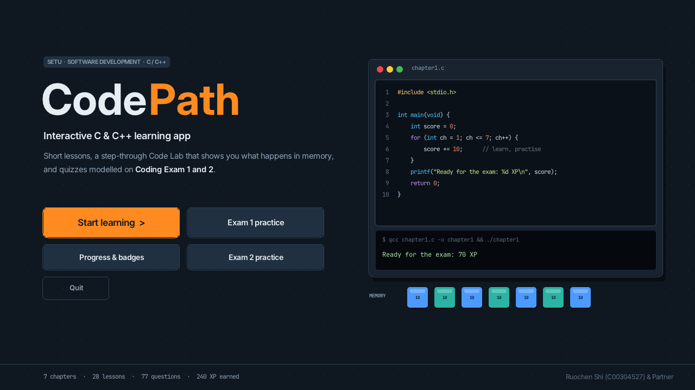
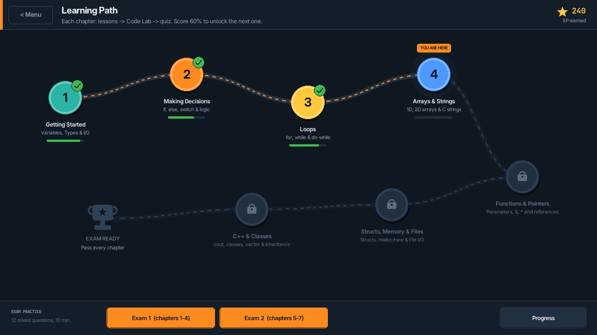
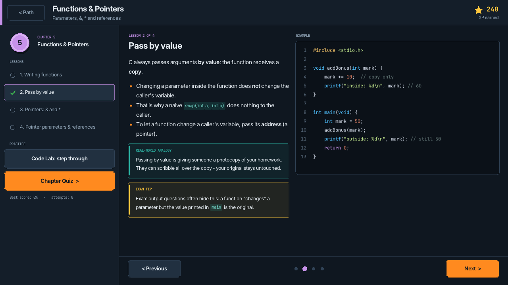
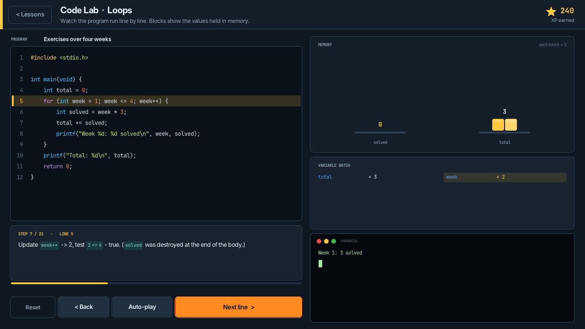
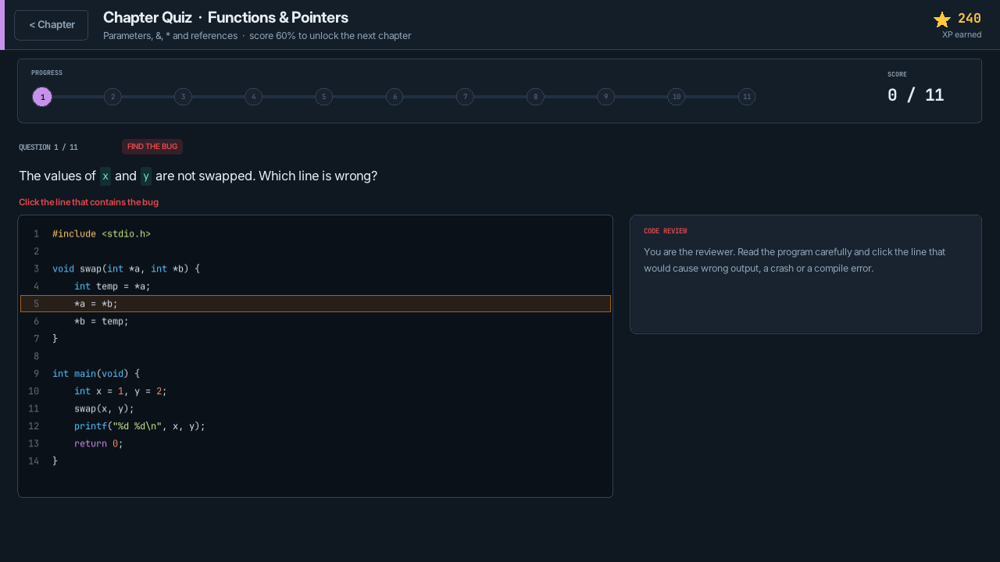
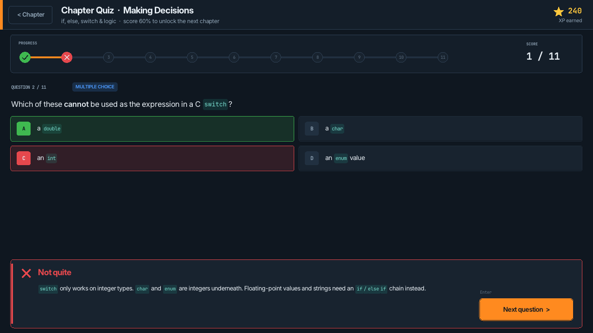
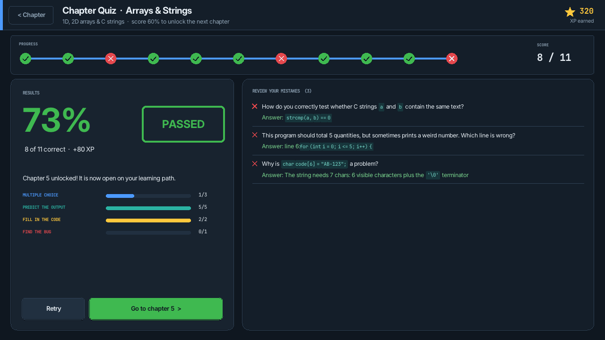
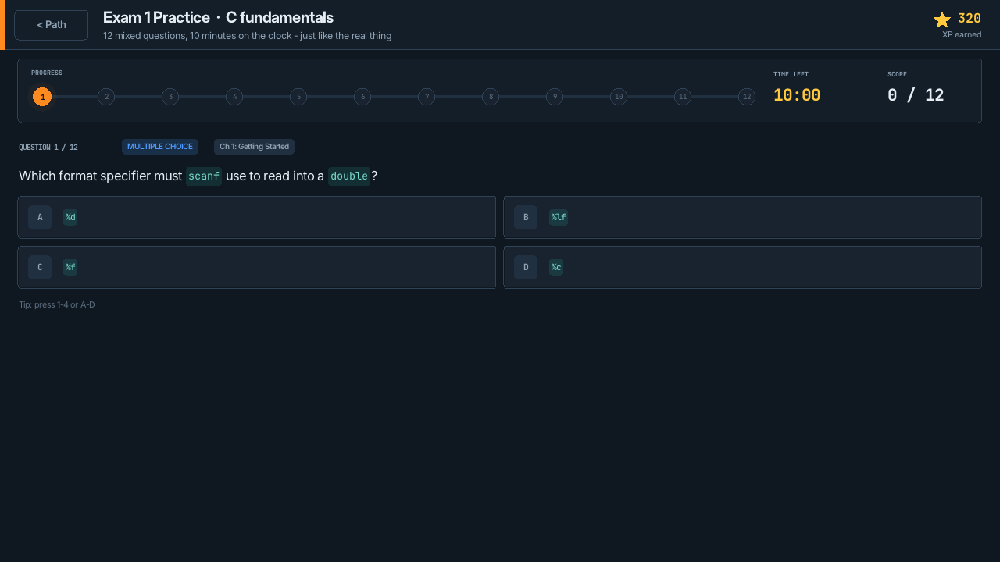
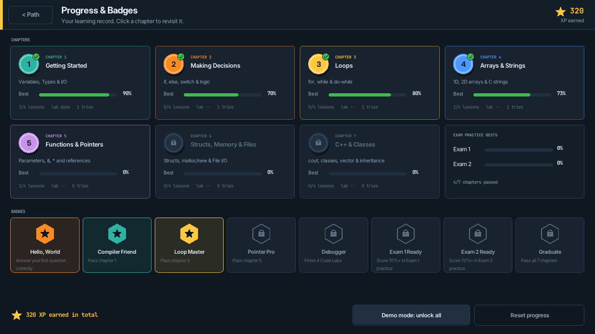

# CodePath – Interactive C & C++ Learning App

An interactive learning app for C and C++, written in **C++17 with raylib 5.5**.
Built for the *Project: AI Interactive C/C++ Learning App* (SETU, Software Development).
It focuses on the material from **Coding Exam 1 and 2** and the lecture notes.

**Team:** Ruochen Shi (C00304527) & Oliwier Nowak (C00307825)



## How it teaches

| Feature | What it does |
|---|---|
| **Learning path** | 7 chapters shown as a path. You must score 60% in a chapter's quiz to unlock the next one. |
| **Lessons** | 4 short lessons per chapter. Each one has an explanation, a syntax-highlighted example program, a real-world analogy card and an exam-tip card. |
| **Code Lab** | A step-through "debugger": the current line is highlighted, the variable watch shows values changing, memory is drawn as stacks of blocks and the console fills up with output. You can go forwards, backwards or auto-play. |
| **Chapter quiz** | 10–11 questions per chapter, in 4 types: multiple choice, **predict the output**, **fill in the code** and **find the bug** (you click the faulty line). Questions and options are shuffled on every attempt. Each answer comes with an explanation. |
| **Exam 1 / Exam 2 practice** | 12 random questions with a 10-minute timer. Exam 1 draws from chapters 1–4 and Exam 2 from chapters 5–7. |
| **Results & review** | Score, a breakdown by question type, and a list of every mistake with the correct answer. |
| **Progress & badges** | XP, best scores, lessons seen and labs finished, all saved to `progress.sav`. "Demo mode" unlocks every chapter for presentations. |

### Chapters

1. **Getting Started**: `main`, variables, types, `printf`/`scanf`, integer division, casting
2. **Making Decisions**: relational and logical operators, `if`/`else`, `switch`, common traps
3. **Loops**: `for`, `while`, `do-while`, `break`/`continue`, accumulators, nested loops
4. **Arrays & Strings**: 1D/2D arrays, sum/max/search, C strings and `<string.h>`
5. **Functions & Pointers**: prototypes, pass by value, `&` and `*`, pointer arithmetic, C++ references
6. **Structs, Memory & Files**: `struct`, `->`, `typedef`, `malloc`/`free`, `new`/`delete`, file I/O
7. **C++ & Classes**: `cout`/`cin`, `string`, classes, constructors, encapsulation, `vector`, inheritance and `virtual`

The app has 28 lessons, 7 Code Labs and 77 questions in total. All content lives in plain text files in
`assets/content/`, so you can edit or extend it without recompiling. The format is described in
[`assets/content/FORMAT.md`](assets/content/FORMAT.md).

## Building

### Option A – CMake (Windows / macOS / Linux, recommended)
CMake downloads raylib 5.5 automatically the first time.
```bash
cmake -S . -B build
cmake --build build --config Release
./build/CodePath          # Windows: build\Release\CodePath.exe
```
This works directly in CLion, or in VS Code with the CMake Tools extension.
The `assets` folder is copied next to the executable after every build.

### Option B – raylib Windows installer (w64devkit / Notepad++)
```bash
g++ -std=c++17 src/*.cpp -o CodePath.exe -I C:/raylib/raylib/src -L C:/raylib/raylib/src -lraylib -lopengl32 -lgdi32 -lwinmm
```
Run it from the project folder so it can find `assets/`.

### Linux dependencies
`sudo apt install build-essential cmake libx11-dev libxrandr-dev libxinerama-dev libxcursor-dev libxi-dev libgl1-mesa-dev`

## Controls
- Mouse for everything. **Esc** goes back.
- Lessons: **← / →** change page, mouse wheel scrolls.
- Code Lab: **Space / →** next line, **←** back, **P** auto-play, **R** reset.
- Quiz: **1–4** or **A–D** pick an answer, **Enter** next question. For fill-in questions, type and press Enter.

## Project structure
```
src/
  main.cpp            entry point
  App.h/.cpp          window, main loop, screen switching, shared top bar, screenshot tour
  Screens.h           declarations of all screens (each is a subclass of Screen)
  MenuScreen.cpp      title screen with a self-typing code editor
  MapScreen.cpp       learning path and chapter unlocking
  ModuleScreen.cpp    lesson pages
  LabScreen.cpp       step-through Code Lab
  QuizScreen.cpp      chapter quizzes, exam practice, results and review
  ProgressScreen.cpp  progress and badges
  Content.h/.cpp      content model and the text-file parser (std::ifstream)
  Progress.h/.cpp     save/load of progress (std::ofstream)
  UI.h/.cpp           immediate-mode widgets, rich text, C/C++ syntax highlighter, drawings
assets/
  content/module1..7.txt   lessons, labs and questions
  fonts/                   Inter + JetBrains Mono (SIL Open Font License)
docs/screenshots/
```

Design notes for the code review:
- **Polymorphism**: the screens share an abstract `Screen` base class with `Update`/`Draw`. `App` holds a `std::unique_ptr<Screen>` and switches screens at the end of the frame.
- **Separation of data and code**: all teaching content is data. The parser reports the file name and line number when it finds an error.
- **Immediate-mode UI**: `UI::Button`, `UI::CodeBlock` and `UI::RichText` need no widget objects, which keeps every screen short.

## Screenshot tour
`./CodePath --tour shots` renders every screen automatically and saves PNGs into `shots/`.
It is useful for checking every screen quickly and for making stills for the journal and screencasts.

## Screens
| | |
|---|---|
|  |  |
|  |  |
|  |  |
|  |  |

## Credits
- [raylib](https://www.raylib.com/) by Ramon Santamaria (zlib licence)
- Inter by Rasmus Andersson and JetBrains Mono by JetBrains (SIL OFL 1.1, licences in `assets/fonts/`)
